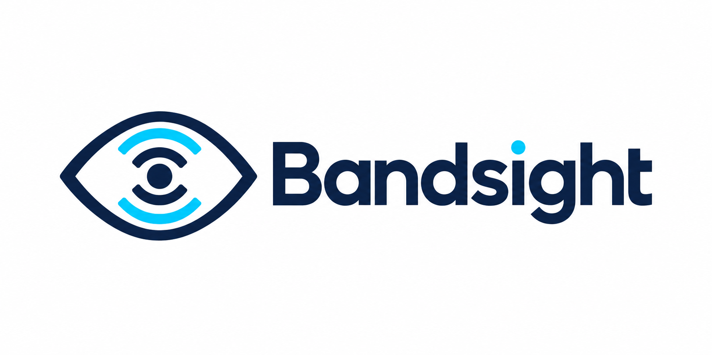
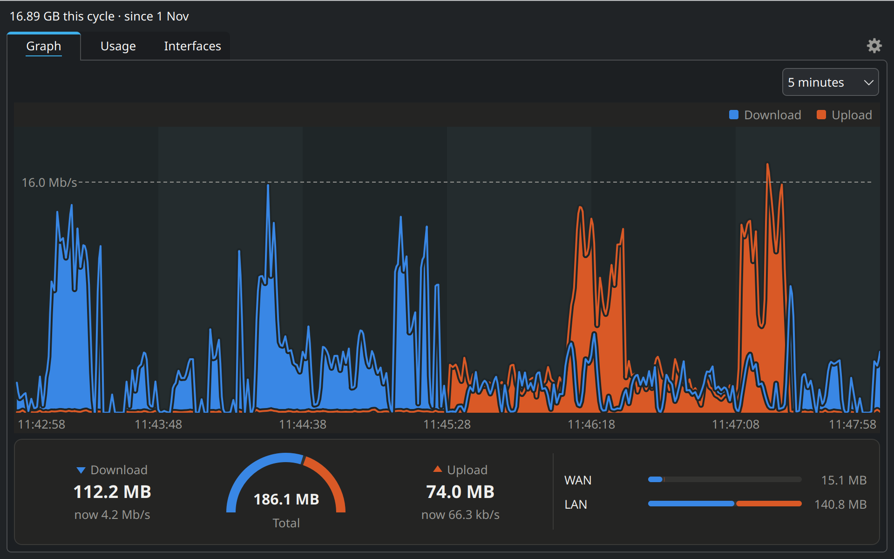
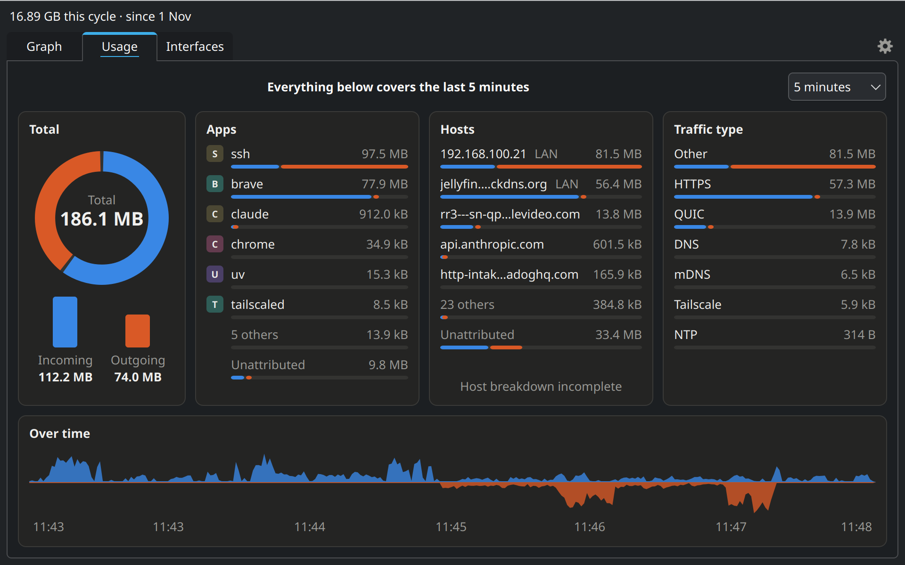
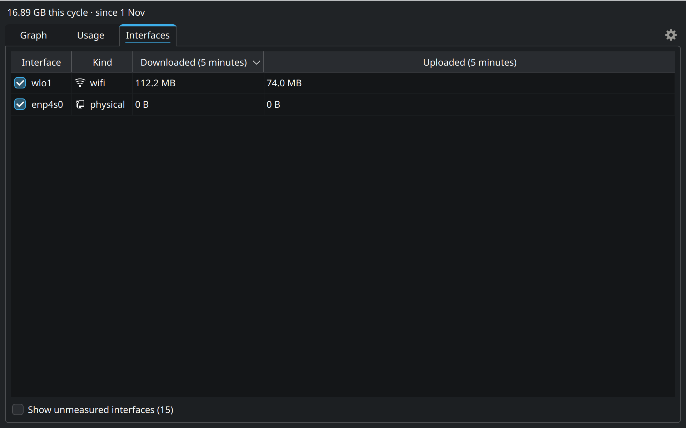
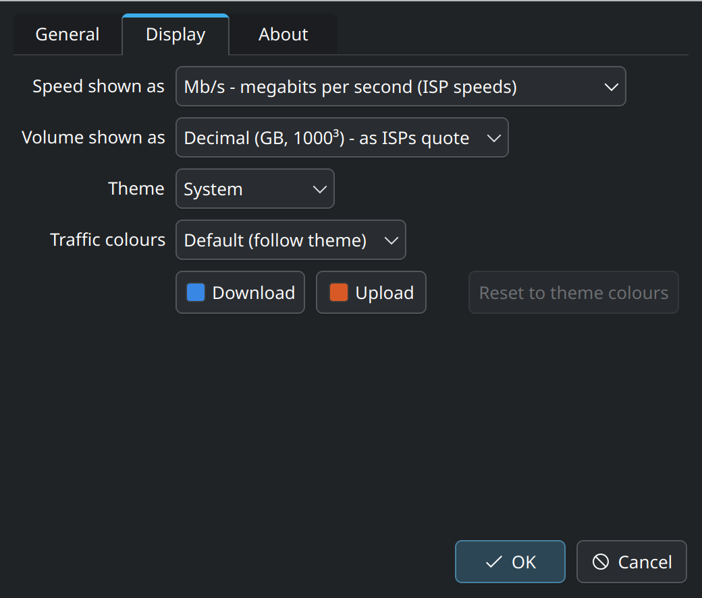
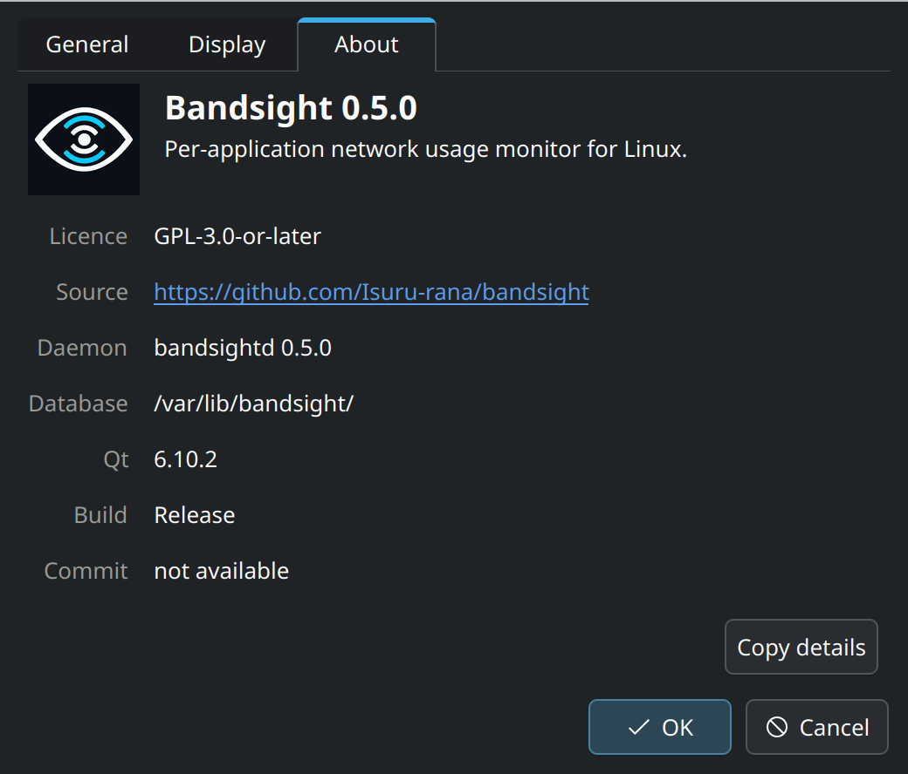

<p align="center">
  <picture>
    <source media="(prefers-color-scheme: dark)" srcset="docs/branding/bandsight-logo-dark.png">
    
  </picture>
</p>

<p align="center"><b>See which apps use your bandwidth on Linux. Always on, kept forever, no packet capture.</b></p>

<p align="center">
  <a href="#what-it-is">What it is</a> ·
  <a href="#features">Features</a> ·
  <a href="#screenshots">Screenshots</a> ·
  <a href="#install">Install</a> ·
  <a href="#command-line">Command line</a> ·
  <a href="#build-from-source">Build from source</a> ·
  <a href="#using-the-data-directly">Using the data</a> ·
  <a href="#known-limitations">Known limitations</a> ·
  <a href="#roadmap">Roadmap</a> ·
  <a href="#contributing">Contributing</a>
  <br>
  <sub>Install on:
  <a href="#debian--ubuntu-debian-12-ubuntu-2404">Debian / Ubuntu</a> ·
  <a href="#fedora--opensuse">Fedora / openSUSE</a> ·
  <a href="#arch-linux">Arch Linux</a></sub>
</p>

> [!WARNING]
> **Bandsight is under active development (v0.6.x, pre-1.0).**
> Tested on Ubuntu 26.04, kernel 7.0, KDE Plasma (Wayland), x86_64. Other distros,
> kernels and desktops are built in CI but not yet tested at runtime.
> The SQLite schema and the socket protocol may change between releases.
> The Connections tab is not implemented yet.

<p align="center">
  
  <br><sub>Graph tab: live and historical traffic, 9 time windows, totals and per-interface split.</sub>
</p>

---

## What it is

Bandsight is a network usage monitor for Linux. It has two parts:

- **`bandsightd`**, a small system daemon that starts at boot and counts bytes per
  network interface (from rtnetlink) and per application (from eBPF socket hooks).
  Everything goes into a local SQLite database.
- **`bandsight`**, a Qt6 desktop app that shows live and historical usage: a traffic
  graph, a per-app usage summary, interface totals, a data cap bar and a tray icon
  with live rates.

The daemon is the only part that records. Close the window, quit the app or never
install the GUI at all, and your usage is still being counted.

Bandsight only monitors. It does not block, firewall, capture packets or read
payloads. It counts bytes and writes them down.

## Why it exists

**Inspired by GlassWire.** GlassWire on Windows made one thing easy: open a window,
see what used your data today, this week, this month, per app. Linux has no real
equivalent, so Bandsight is an attempt at that experience, built the Linux way
(systemd service, eBPF, SQLite, Qt).

**Built to fix my own problems with Sniffnet.** Sniffnet is a great traffic
inspector, and I used it. But I wanted to answer "where did my data go this month?",
and Sniffnet is built around live capture sessions, not long term accounting. These
are the things I needed that Sniffnet does not do, and that Bandsight does:

| Need | Sniffnet | Bandsight |
|---|---|---|
| Keep counting when the app is closed | Only sees traffic while the app is running a capture | Daemon counts from boot, GUI optional |
| History across restarts and reboots | Stats belong to the current session | SQLite history with rollups: 1 minute up to 30 days in the graph, daily totals kept forever |
| Monthly data cap with billing cycle | No | Cap, cycle start day, usage bar and end of cycle projection |
| All interfaces at once | One adapter per capture | Every physical and Wi-Fi interface, with per-interface filters |
| Run the viewer without root | Capture needs elevated privileges for the app itself | Only the daemon is privileged; the GUI is a normal user app (member of the `bandsight` group) |
| No packet capture | Captures packets with libpcap | Counts bytes in the kernel with eBPF, never reads packet contents |
| Tray icon with live rates | No | Yes (StatusNotifier) |
| Apps that start and exit quickly | | Caught via exec events; apps already running at daemon start are seeded from `/proc` |

To be fair, Sniffnet has plenty that Bandsight does not: per-country views, protocol and service detection, notifications and PCAP import/export.
If you want to inspect traffic, use Sniffnet. If you want to account for it over
time, that is what Bandsight is for.

## Features

- Per-application download and upload totals, attributed in the kernel by eBPF
- Interface totals that match what your ISP sees (physical and Wi-Fi only, so VPN,
  loopback and virtual interfaces are not double counted)
- Traffic graph with 9 windows: 1 min, 5 min, 30 min, 1 h, 6 h, 12 h, 24 h, 7 days, 30 days
- Usage view: total donut with download/upload split, apps ranked by usage, timeline
- Hosts column: bytes per remote host, per app, named by the domain the app looked up
  (via systemd-resolved) and tagged LAN or WAN
- Traffic type column: bytes per service (HTTPS, QUIC, DNS, SSH, …), from socket ports
- Data cap with a billing cycle start day and a projection to the end of the cycle
- Tray icon showing current rates; closing the window hides it to the tray
- Themes: System (follows the desktop's light or dark mode), Light, Dark, High contrast,
  Sand and Slate, each checked for text contrast and colour-blind safe download/upload colours
- Download/upload colour presets (including Blue / Yellow for red-green colour blindness)
  or your own pair, with a warning if your pick is hard to see
- Speed in Mb/s or MB/s and volume in GB or GiB, applied everywhere as soon as you pick them
- Settings from the gear next to the tabs, `Ctrl+,` or the tray menu; About shows the GUI and
  daemon versions and copies them for bug reports
- Hardened systemd service (narrow capabilities, `ProtectSystem=strict`, `NoNewPrivileges`)
- `bandsight-cli` for terminals and headless servers: status, apps, hosts, traffic types,
  interfaces and live rates, as tables or `--json`, with no Qt needed
- Live JSON feed over a Unix socket for your own scripts

## Screenshots

**Usage:** total with download/upload split, apps, hosts and traffic types ranked by usage, timeline of the selected period. Whatever the apps do not account for shows as Unattributed.



**Interfaces:** per-interface totals; checkboxes filter the graph. Loopback, VPN and virtual interfaces are hidden by default because their traffic is already counted on the physical interface.



**Settings:** units, theme and download/upload colours apply as soon as you pick them. About shows the GUI and daemon versions.

<p>
  
  
</p>

## Requirements

- Linux with systemd
- A kernel with BTF enabled (`/sys/kernel/btf/vmlinux` exists). This is the default on
  current Debian, Ubuntu, Fedora, openSUSE and Arch kernels.
- x86_64 or aarch64

Without root (or if the eBPF hooks cannot attach) the daemon still records
interface totals, just not the per-app breakdown, and logs why.

## Install

What each version added, changed, fixed and removed: [CHANGELOG.md](CHANGELOG.md).

### Debian / Ubuntu (Debian 12+, Ubuntu 24.04+)

Add the Bandsight package source once, then install:

```bash
curl -fsSL https://isuru-rana.github.io/bandsight/key.gpg | sudo gpg --dearmor -o /usr/share/keyrings/bandsight.gpg
echo "deb [signed-by=/usr/share/keyrings/bandsight.gpg] https://isuru-rana.github.io/bandsight stable main" | sudo tee /etc/apt/sources.list.d/bandsight.list
sudo apt update && sudo apt install bandsight
```

New versions then arrive with `sudo apt update && sudo apt upgrade`. Every
release stays available, so `sudo apt install bandsight=0.3.0` goes back to one.

Prefer a one-off download? Each [release](https://github.com/Isuru-rana/bandsight/releases)
also carries the `.deb`: `sudo apt install ./bandsight_*_amd64.deb`.

### Fedora / openSUSE

Download the `.rpm` from the [Releases](https://github.com/Isuru-rana/bandsight/releases) page:

```bash
sudo dnf install ./bandsight-*.x86_64.rpm        # Fedora
sudo zypper install ./bandsight-*.x86_64.rpm     # openSUSE
```

The `.deb` and `.rpm` packages create the `bandsight` group and enable and start
`bandsightd` for you.

### Arch Linux

A `PKGBUILD` lives in [`packaging/arch/`](packaging/arch/). A prebuilt
`.pkg.tar.zst` is also attached to each release:

```bash
sudo pacman -U bandsight-*.pkg.tar.zst
sudo systemctl enable --now bandsightd
```

### After installing (all distros)

Add yourself to the `bandsight` group, then log out and back in:

```bash
sudo usermod -aG bandsight $USER
```

The GUI reads the daemon's database directly, and the database directory is only
open to that group. Without it the window still opens and tells you the exact
command to run. Then launch **Bandsight** from your app menu, or run `bandsight`.

Anyone in the `bandsight` group can see per-app usage for every process on the
machine, so add users accordingly.

## Command line

`bandsight-cli` shows the same history as the GUI in a terminal, for servers and SSH
sessions. It is installed with the daemon and needs no Qt or desktop. History
commands read the database, so they work while `bandsightd` is stopped. `live`,
`status` and `top` only read from the daemon's socket and never send it anything.

Like the GUI, it needs the `bandsight` group (see [After installing](#after-installing-all-distros)).

| Command | Shows |
| --- | --- |
| `bandsight-cli status` | whether `bandsightd` is running and its version, the database, the billing cycle (used, cap, projection) and the current rate |
| `bandsight-cli apps [--period P] [--limit N]` | download and upload per application |
| `bandsight-cli hosts [--period P] [--app NAME] [--limit N]` | per remote host, with its name and LAN or WAN |
| `bandsight-cli types [--period P]` | per kind of traffic (HTTPS, QUIC, DNS, SSH, …) |
| `bandsight-cli ifaces [--period P] [--all]` | per interface (`--all` adds loopback, VPN and virtual ones) |
| `bandsight-cli live [--interval S] [--count N]` | current rates until Ctrl-C |
| `bandsight-cli top [--period P] [--ascii]` | a full-screen live view: rates, the last 60 s, the cycle, apps, hosts and traffic types |

Periods: `5m 30m 1h 6h 12h 24h 7d 30d` (the GUI's windows; default `24h`), `cycle`
(the billing cycle so far), or `--from T [--to T]` in local time
(`2026-11-05`, `2026-11-05T14:30`). Rates are shown in Mb/s and volumes in decimal GB
like the GUI; `--bytes` gives MB/s and `--binary` gives GiB. Past `--limit` (default 10,
`0` for all) the remaining rows are folded into one "N others" row. Colour and bars are
used only on a terminal, and never when `NO_COLOR` is set. `bandsight-cli --help` and
`bandsight-cli <command> --help` list every option.

```console
$ bandsight-cli apps --limit 5
Applications, last 24 hours (2026-11-04 12:00 to 2026-11-05 12:00)

APPLICATION             DOWN        UP     TOTAL
Firefox             656.5 MB   13.3 MB  669.9 MB
node (v24.1.0/bin)  210.0 MB    4.2 MB  214.2 MB
ssh                  15.2 MB   93.8 MB  109.0 MB
Spotify              84.0 MB    1.2 MB   85.2 MB
curl                 26.0 MB  310.0 kB   26.3 MB
3 others             11.7 MB    8.0 MB   19.7 MB
Unattributed        421.0 MB   21.1 MB  442.1 MB

Total on measured interfaces: 1.42 GB down, 141.9 MB up, 1.57 GB in all
Unattributed: counted on the interfaces but not credited to any application
(virtual machines, containers, kernel traffic such as WireGuard).

$ bandsight-cli hosts --limit 4
Hosts, last 24 hours (2026-11-04 12:00 to 2026-11-05 12:00)

HOST                     ADDRESS          NET      DOWN       UP     TOTAL
one.one.one.one          2606:4700::1111  WAN  644.5 MB  12.7 MB  657.2 MB
registry.npmjs.org       104.16.0.35      WAN  213.3 MB   4.3 MB  217.6 MB
192.168.1.10                              LAN   15.2 MB  93.8 MB  109.0 MB
spclient.wg.spotify.com  35.186.224.25    WAN   84.0 MB   1.2 MB   85.2 MB
4 others                                        47.7 MB   8.9 MB   56.5 MB
Unattributed                                   419.8 MB  21.0 MB  440.8 MB

Total on measured interfaces: 1.42 GB down, 141.9 MB up, 1.57 GB in all

$ bandsight-cli status
bandsightd  running, version 0.5.0
Database    /var/lib/bandsight/bandsight.db
Cycle       1 Nov 2026 to 1 Dec 2026 (renews on day 1)
Used        1.78 GB of 100.00 GB cap (1%)
Projected   11.89 GB by 1 Dec 2026
Now         down 10.0 Mb/s, up 254.0 kb/s

$ bandsight-cli live --count 3
12:00:21  down   10.0 Mb/s  up  254.0 kb/s
12:00:22  down   11.0 Mb/s  up  250.0 kb/s
12:00:23  down   12.0 Mb/s  up  254.0 kb/s
```

### Live view: `top`

`bandsight-cli top` is a full-screen view in the style of `htop`, for an SSH session
or a spare terminal. The header shows whether `bandsightd` is running and its
version, the current download and upload rate, and the billing cycle (used, cap and
projection). Below it, the last 60 seconds as a sparkline, then three panels for the
selected period: Applications, Hosts and Traffic types, each with down/up bars and,
for apps and hosts, an Unattributed row like the GUI's.

```text
Bandsight  bandsightd 0.5.0 running                          2026-11-05 12:00:30
Now     down  156.8 Mb/s   up  128.0 kb/s
Cycle   1.78 GB of 100.00 GB (1%), projected 11.89 GB by 1 Dec 2026

Last 60 s
down ▆▅▄▃▃▂▂▁▁▁▁▁▁▁▁▁▁▁▂▂▃▃▄▅▆▇▇█▇▇▆▅▄▃▃▂▂▁▁▁▁▁▁▁▁▁▁▁▂▂▃▃▄▅▆▇▇  peak 180.0 Mb/s
up   ▆▇█▁▂▃▅▆▇█ ▂▃▄▆▇█ ▂▃▄▆▇█▁▂▃▅▆▇█ ▂▃▄▆▇█ ▂▃▄▆▇█▁▂▃▅▆▇█ ▂▃▄▆  peak 196.0 kb/s

▶ 1 Applications  last 24 hours                                        1-3 of 9
 APPLICATION                   DOWN         UP
 Firefox                   656.5 MB    13.3 MB  █████████████████████████████░
 node (v24.1.0/bin)        210.0 MB     4.2 MB  █████████░
 ssh                        15.2 MB    93.8 MB  █░░░░
  2 Hosts  last 24 hours                                               1-3 of 9
 HOST                          DOWN         UP
 one.one.one.one           644.5 MB    12.7 MB  █████████████████████████████░
 registry.npmjs.org        213.3 MB     4.3 MB  ██████████░
 192.168.1.10               15.2 MB    93.8 MB  █░░░░
  3 Traffic types  last 24 hours                                       1-3 of 5
 SERVICE                       DOWN         UP
 QUIC                      644.5 MB    12.7 MB  █████████████████████████████░
 HTTPS                     336.6 MB     6.5 MB  ███████████████░
 SSH                        15.2 MB    93.8 MB  █░░░░
 1/2/3 Tab panel  p period (24h)  b units (Mb/s)  ↑↓ j/k scroll  q quit
```

| Key | Does |
| --- | --- |
| `1` `2` `3`, `Tab` | focus Applications, Hosts or Traffic types |
| `p` (`P` back) | next period: `5m 1h 24h 7d 30d cycle` |
| `b` | rates in Mb/s or MB/s |
| `↑` `↓`, `j` `k` | scroll the focused panel (also PgUp/PgDn, Home/End, `g`/`G`) |
| `q`, `Ctrl-C` | quit |

Live rates are read from the daemon's socket every second; like `live`, `top` only
reads and never sends the daemon anything. The panels are read from the database
every 5 seconds, so they keep working while `bandsightd` is stopped (the header then
says so, and `top` reconnects when the daemon is back). It needs a terminal: from a
script it exits with status 2 (use `status --json` or `live --json` there). Colour is
off with `NO_COLOR`; unicode blocks fall back to ASCII outside a UTF-8 locale or with
`--ascii`. `--period`, `--bytes`, `--binary`, `--db` and `--socket` set where it starts.

### JSON

`--json` works on every command. It prints one JSON object on one line (`live` prints
one per line), with byte counts as plain integers and times in ISO 8601 with the local
offset. Keys are stable, and new keys may be added. Absent values are `null`.

```console
$ bandsight-cli apps --period 7d --json | jq -r '.apps[] | "\(.total_bytes)\t\(.label)"'
$ bandsight-cli status --json | jq '.cycle.used_bytes'
```

| Command | Keys |
| --- | --- |
| every history command | `command`, `period` {`name` (`24h`, `cycle`, `custom`…), `from`, `to`, `resolution_s`} |
| `apps` | `total`, `apps[]` {`label`, `name`, `exe`}, `others` {`count`}, `unattributed` |
| `hosts` | `app`, `collected`, `recorded_since`, `total`, `hosts[]` {`label`, `ip`, `hostname`, `zone` (`lan`, `wan`, `none`), `apps[]` {`label`, `exe`, `total_bytes`}}, `others`, `unattributed` |
| `types` | `collected`, `recorded_since`, `types[]` {`service`, `ports[]` {`proto`, `port`}} |
| `ifaces` | `total`, `interfaces[]` {`name`, `kind`, `measured`, `ids[]`} |
| `status` | `daemon` {`running`, `state`, `version`, `socket`}, `database` {`path`}, `cycle` {`start`, `end`, `renewal_day`, `used_bytes`, `cap_bytes`, `projected_bytes`}, `live` {`ts`, `down_bytes_per_s`, `up_bytes_per_s`} |
| `live` (per line) | `ts`, `interval_s`, `down_bytes_per_s`, `up_bytes_per_s`, `interfaces[]` {`id`, `name`, `down_bytes_per_s`, `up_bytes_per_s`} |

Every row object (`total`, each app, host, type, port and interface, `others` and
`unattributed`) carries `down_bytes`, `up_bytes` and `total_bytes`.

Exit status: `0` success, `1` runtime error (no database, no permission, daemon not
running for `live`), `2` usage error. Errors go to stderr in plain words, for example:

```text
Cannot read /var/lib/bandsight/bandsight.db: add yourself to the 'bandsight' group (sudo usermod -aG bandsight $USER), then log in again.
bandsightd is not running; showing history only.
```

## Build from source

Debian / Ubuntu dependencies:

```bash
sudo apt install build-essential cmake pkg-config libsqlite3-dev libbpf-dev clang bpftool \
    qt6-base-dev libqt6charts6-dev libqt6sql6-sqlite
```

Fedora:

```bash
sudo dnf install gcc-c++ cmake pkgconf-pkg-config sqlite-devel libbpf-devel clang bpftool \
    qt6-qtbase-devel qt6-qtcharts-devel
```

Build and install:

```bash
cmake -B build -DCMAKE_BUILD_TYPE=Release -DCMAKE_INSTALL_PREFIX=/usr
cmake --build build
sudo cmake --install build
sudo groupadd --system bandsight
sudo systemctl daemon-reload
sudo systemctl enable --now bandsightd
```

`bpf/vmlinux.h` is committed, so building does not need BTF on the build machine.
To build only the daemon and `bandsight-cli`, pass `-DBANDSIGHT_BUILD_GUI=OFF` (the GUI is
also skipped automatically when Qt6 is missing); Qt is then not needed at all.

Build your own packages with `cd build && cpack -G DEB` or `cpack -G RPM`.

## Using the data directly

The database is `/var/lib/bandsight/bandsight.db` (SQLite, WAL mode). Per-app totals
for the current month:

```bash
sqlite3 -readonly /var/lib/bandsight/bandsight.db <<'SQL'
SELECT a.name, SUM(s.rx) AS rx_bytes, SUM(s.tx) AS tx_bytes
FROM app_samples s
JOIN apps a ON a.id = s.app_id
JOIN ifaces i ON i.id = s.iface_id
WHERE s.res = 86400
  AND i.kind IN ('physical', 'wifi')
  AND s.ts >= strftime('%s', date('now', 'start of month'))
GROUP BY a.id
ORDER BY rx_bytes + tx_bytes DESC;
SQL
```

The daemon also pushes live updates on `/run/bandsightd/sock`. Server to client frames
are a 4-byte little-endian length followed by JSON: one `hello` frame, then a
`sample` frame about once a second. Client commands are newline-terminated JSON,
for example `{"cmd":"ping"}`.

## Known limitations

1. **Per-app totals read about 5 to 10% below interface totals.** eBPF counts payload
   bytes at the socket layer, the interface counts wire bytes including headers and
   retransmits. GlassWire shows the same gap for the same reason.
2. **Host names need systemd-resolved.** Names come from the lookups resolved
   answers, so a host shows as its IP when nothing looked it up through resolved:
   LAN peers, direct-IP connections, apps with their own encrypted DNS, or systems
   without resolved. A shared server IP shows the name it was most recently looked
   up by. Host data is kept at minute resolution, so windows under one hour are
   prorated from whole minutes.
   Upgrading from 0.1.x: per-app history recorded before 0.2.0 may include traffic
   between containers, wrongly credited to a physical interface. Interface totals,
   the graph and the data cap were never affected.
3. **Kernel updates can break the per-app hooks.** If attach points drift, the daemon
   falls back to interface totals only and logs which hook failed.
4. **The 5 minute view starts empty** after launching the GUI. It is drawn from the
   live feed; longer windows come from history and are complete immediately.
5. **The tray icon needs a StatusNotifier host.** Native on KDE; GNOME needs the
   AppIndicator extension.
6. **No connection list or per-app blocking yet.** Both are on the roadmap.

## Roadmap

- Connections tab (live list of sockets per app)
- Per-app blocking (opt-in, after monitoring is solid)
- AUR package

## Contributing

Issues and pull requests are welcome. With bug reports, please include your distro,
the versions from **Settings > About > Copy details** (or `bandsightd --version`), and
`journalctl -u bandsightd -b` output.

## Licence

GPL-3.0-or-later. See [LICENSE](LICENSE).
